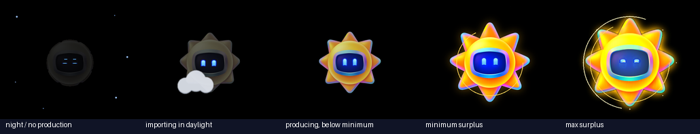
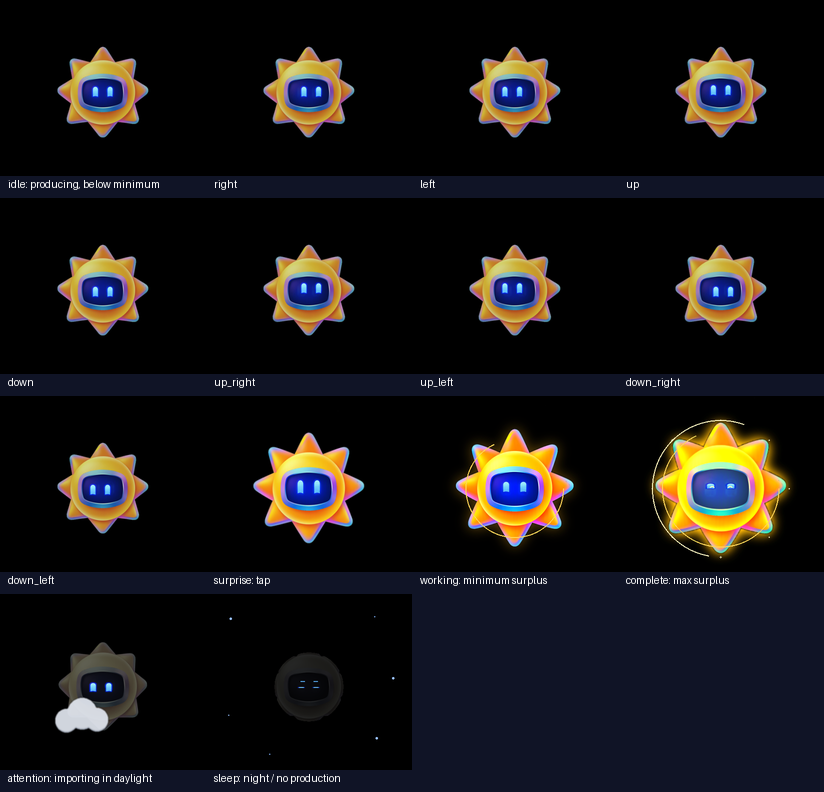
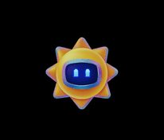

# Solar character pack

An importable Solar character pack for [solar-agent](https://github.com/sujithq/solar-agent),
created from the supplied sun-robot artwork. The original image is retained at
`characters/solar/source/solar.png`; its pale background is removed for the
device's black canvas. The whole sun changes with the solar level, so each
level is readable from across a room.

## Solar levels

In solar mode, [solar-agent](https://github.com/sujithq/solar-agent) maps each
solar level to one of the pack's existing tracks; the `.acpk` format is unchanged.

| Solar level | Track | Look |
|---|---|---|
| Night / no production | Sleep (12) | Dark, compact disc with closed eyes and twinkling stars |
| Importing in daylight | Attention (11) | Small, faded sun partly hidden behind a grey cloud |
| Producing, below minimum | Idle (0-7) | Compact pale-yellow sun, short rays, neutral eyes |
| Minimum surplus | Working (9) | Full-size orange sun, brighter rays and a rotating halo |
| Max surplus (default 5 kW, configurable in solar-agent) | Complete (10) | 120% sun, long rays, double orbit, white-hot core and sparkles |

Tapping the character still plays Surprise (8). Every track starts from the same
neutral pose and holds its full look on its last pose. Night detection and the
thresholds are computed by solar-agent; earlier solar-agent versions use their
existing state mapping, where these tracks may look different from their names.



The level silhouettes and brightness are designed to remain distinct in
grayscale; the maximum-surplus rays remain inside the 412x352 display canvas.

## Import

In solar-agent, open **Settings > Add character pack** and select
[`build/characters/solar.acpk`](build/characters/solar.acpk).

The pack uses the native 412x352 RGB565 base-patch format, all 13 tracks and
five blink levels. Idle up/down have 12 poses; the other tracks have 24.
Blinks only redraw the eyes, so the blink patch stays below the legacy
7,452-pixel buffer limit.
Sleep is supplied both as an expression track and through closed-eye blink
levels, matching the firmware's sleep behavior.





## Rebuild

Python 3.11 or newer:

```powershell
python -m pip install -r requirements.txt
python tools\generate_solar.py
python tools\character_pack.py validate build\characters\solar.acpk
python -m unittest discover -s tests
```

The dependency file uses the Microsoft package feed proxy. Regeneration
recreates the frame data, metadata, PNG/GIF previews, and finished pack.
To rebuild only the pack from existing frame data:

```powershell
python tools\character_pack.py build
```

## Upstream sources

These files are copied unchanged from
[`sujithq/solar-agent` at `555e01aead6e1551d218568cdefb1d75d635a894`](https://github.com/sujithq/solar-agent/tree/555e01aead6e1551d218568cdefb1d75d635a894):

- [`tools/character_pack.py`](https://github.com/sujithq/solar-agent/blob/555e01aead6e1551d218568cdefb1d75d635a894/tools/character_pack.py): pack builder and validator.
- [`tools/sprite_codec.py`](https://github.com/sujithq/solar-agent/blob/555e01aead6e1551d218568cdefb1d75d635a894/tools/sprite_codec.py): required RGB565 decoder.
- [`firmware/AgentCompanion/partitions.csv`](https://github.com/sujithq/solar-agent/blob/555e01aead6e1551d218568cdefb1d75d635a894/firmware/AgentCompanion/partitions.csv): device partition limit used by both CLI commands; this repository does not contain firmware.

Their MIT license and copyright notice are preserved in
[`tools/LICENSE.solar-agent`](tools/LICENSE.solar-agent).

The format and import workflow follow the upstream
[character documentation](https://github.com/sujithq/solar-agent/blob/555e01aead6e1551d218568cdefb1d75d635a894/characters/README.md).
